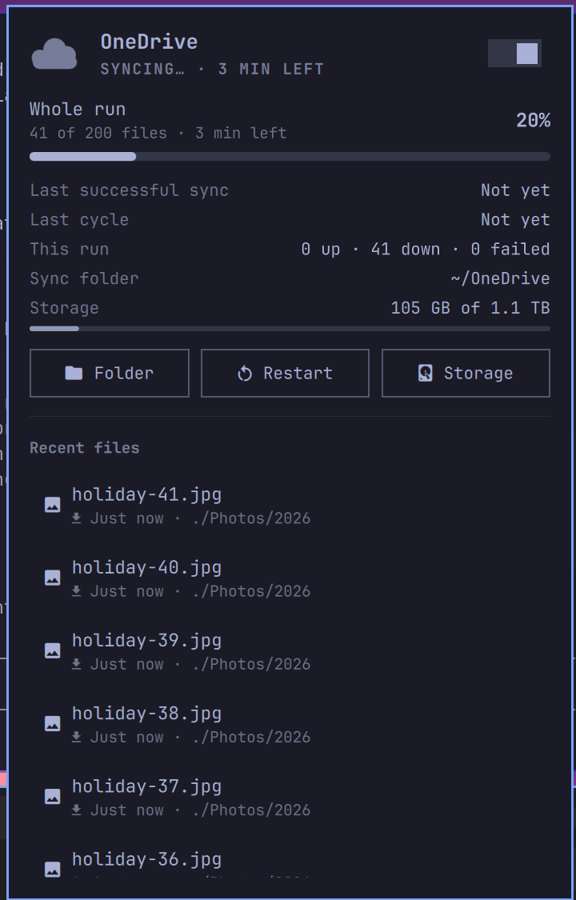
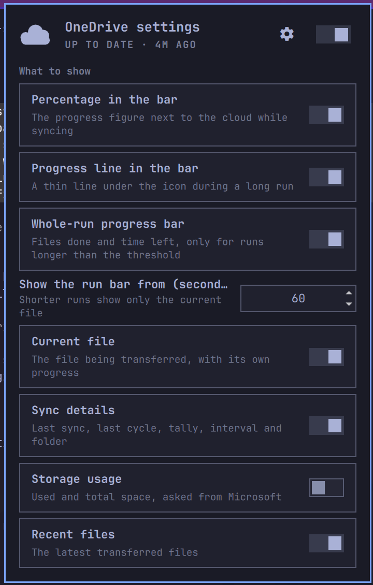

# OneDrive for Omarchy

The [OneDrive Client for Linux](https://github.com/abraunegg/onedrive) in the
**Omarchy bar**: what it is doing, how far a long sync has come, the file it
is on, pause and resume, a status check, and a settings view where every part
can be switched off. The client itself has no tray icon, so without this the
bar shows nothing about your sync.



- **One cloud icon.** It pulses while syncing, shows the percentage of the run
  (or of the file in flight) next to it, and fills a thin line under itself
  while a long run is on. Crossed out when the service is paused; a `!` badge
  when the last cycle failed, OneDrive is unreachable, or the client logged an
  error in the last ten minutes.
- **Whole-run progress.** The client announces how many items it will move;
  the panel turns that into files done, a progress bar and the time left,
  re-estimated from the last two minutes so a run that moves from big videos
  to small text files corrects itself. Shown only when the run is projected to
  take longer than a threshold (1 minute by default), so a two-file sync does
  not flash a bar at you.
- **The current file**, with its own percentage and ETA, straight from the
  client's log.
- **Sync details**: last successful sync, last cycle result, this run's tally
  (up / down / failed), pending uploads, completed cycles, check interval and
  the sync folder. Storage usage (used of total, asked from Microsoft) is
  there too, off by default.
- **Actions**: open the folder, restart the service, **Check** (runs the
  client's own pending-changes query and shows the answer), refresh storage.
  Right click on the icon pauses or resumes, middle click opens the folder.
- **Failure notifications**: a desktop toast when a cycle ends with failures,
  OneDrive was unreachable, or the client logs an error. At most one per five
  minutes, switchable.
- **Client management** from the settings view: start the service at login
  (on/off), client version, **client update check** against the AUR and the
  upstream release with a one-click install, edit the config and the
  `sync_list`, and sign in again.
- **Keyboard first**, like the rest of the shell: arrows, Enter, `p` pause,
  `o` folder, `r` restart, `c` check, `s` settings, Esc back.
- **Translated**: English and Dutch ship; add a language by dropping a JSON
  file in `i18n/`.

## Requirements

- **Omarchy 4.0 or newer** (shell plugins arrived in 4.0 "Quattro"; built and
  tested on 4.5).
- **The OneDrive Client for Linux, 2.5 or newer**, running as the `onedrive`
  user service. The widget reads the `monitor-status.json` the 2.5 client
  publishes in monitor mode, and its journal.

  ```
  omarchy pkg aur add onedrive-abraunegg
  onedrive                              # first run: sign in
  systemctl --user enable --now onedrive
  ```

  `jq`, `curl`, `vercmp` and `notify-send` are used for the update check and
  notifications; Omarchy ships them.

## Install

```
omarchy plugin add https://github.com/baskb/omarchy-onedrive
```

Say yes to enable it and pick a bar section (right is the default). Or later:

```
omarchy plugin enable baskb.onedrive --section right
omarchy bar move baskb.onedrive --before omarchy.tailscale
```

Update with `omarchy plugin update baskb.onedrive`.

## Settings

Press the gear in the panel header (or `s`). Every switch applies at once and
is stored on the widget's entry in `~/.config/omarchy/shell.json`, so the CLI
works too: `omarchy bar set baskb.onedrive showStorage true --json`.



| Setting | Default | Effect |
|---|---|---|
| `showPercentInBar` | on | Run or file percentage next to the icon |
| `showBarProgress` | on | Thin line under the icon during a long run |
| `showRunCard` | on | The whole-run card in the panel |
| `runBarMinSec` | 60 | Show the run bar only when the run is projected past this |
| `showTransferCard` | on | The current-file card |
| `showSyncDetails` | on | The info rows |
| `showStorage` | off | Used/total space and the Storage button |
| `showRecent` | on | The recent files list |
| `recentLimit` | 12 | List length |
| `showActions` | on | The action buttons |
| `notifyOnFailure` | on | Desktop notification on failures |
| `checkUpdates` | on | Ask the AUR and GitHub for a newer client (network) |
| `updateCheckHours` | 6 | How long an update check is trusted |
| `refreshIntervalSec` | 10 | How often the unit state is polled |
| `quotaRefreshMin` | 30 | How often storage may be asked from Microsoft |

"Start syncing at login" is not a widget setting but the unit's enabled
state; the switch runs `systemctl --user enable` or `disable`.

## How it works

| Source | Used for |
|---|---|
| `~/.config/onedrive/monitor-status.json` | idle / syncing / degraded, last cycle, counters, reachability |
| `journalctl --user -u onedrive -o json -f` | run totals ("Number of items to download: N"), per-file `... 45% \| ETA` lines, finished files, errors. A restarted follow resumes from the journald cursor. |
| `systemctl --user is-active / is-enabled onedrive` | paused vs running, start at login; `start`, `stop`, `restart`, `enable`, `disable` for the controls |
| `onedrive --display-quota` | storage (rate limited, only when shown) |
| `onedrive --display-sync-status` | the Check button; this is slow on a large account (minutes) |
| `pacman -Q`, AUR RPC, GitHub releases API | the client update check |

Everything that comes from the log, a command or the network is rendered as
plain text and validated before use; version strings are shape-checked before
they reach `vercmp`. The update check is the only thing that talks to the
network on its own, and it can be switched off.

### Updating the client

On Omarchy the client is the AUR package `onedrive-abraunegg`. `omarchy
update` runs `yay -Sua`, which upgrades it with every other AUR package, so an
ordinary Omarchy update keeps it current. Omarchy's own update widget only
watches the `omarchy` package, which is why this widget has its own check.
Installing goes through the same yay, in a terminal, with the service
restarted onto the new binary afterwards.

## IPC

```
omarchy-shell baskb.onedrive toggle|open|close|settings
omarchy-shell baskb.onedrive pause|resume|restart|folder|refresh
omarchy-shell baskb.onedrive check          # run the pending-changes query
omarchy-shell baskb.onedrive checkResult    # its answer
omarchy-shell baskb.onedrive checkUpdates   # run the client update check
omarchy-shell baskb.onedrive updates        # its answer
omarchy-shell baskb.onedrive status         # one line, e.g. "Syncing 21% (41/200 files, 3 min left)"
omarchy-shell baskb.onedrive set <key> <json>
```

A Hyprland binding, in `~/.config/hypr/bindings.lua`:

```lua
o.bind("SUPER + SHIFT + O", "OneDrive", { panel = "baskb.onedrive" })
```

## Development

Clone into `~/.config/omarchy/plugins/baskb.onedrive` (or `omarchy plugin
add` a fork). `Panel.qml` hot-reloads on save; after editing `Service.qml`
run `omarchy restart shell`. `node Model.test.js` runs the parser tests,
`omarchy plugin validate .` checks the manifest, and `test/README.md`
explains how to replay a fake 200-file run to see the progress bars without
real traffic.

Files: `Panel.qml` (bar icon, panel, settings view, keyboard), `Service.qml`
(status file, journal follow, unit control, client commands), `Model.js`
(all parsing, pure functions, tested), `OneDriveIcon.qml`, `i18n/`.

## License

MIT. Not affiliated with Microsoft or with the OneDrive Client for Linux
project.
